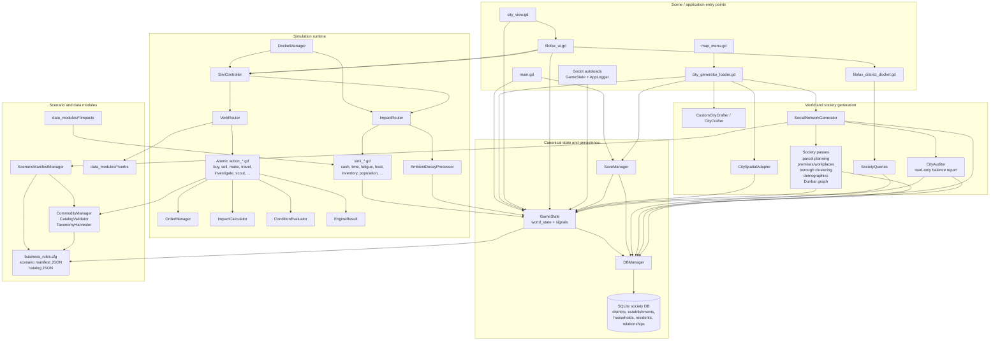
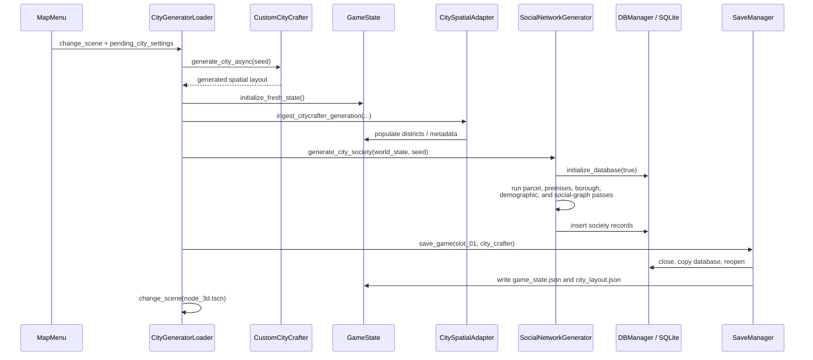
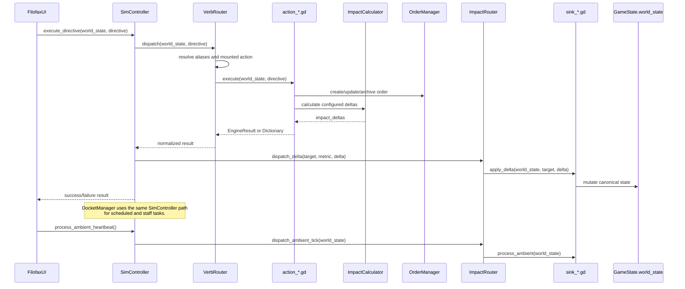

# Core Systems Architecture

This diagram is based on the current Godot scripts under `systems/`, the
`data_modules/` runtime modules, and the scene scripts that call them. Arrows
show the primary code-level dependency or call direction, not every incidental
reference.

## Component relationships

## City creation and load sequence

On a continue/load path, `MainMenu` calls `SaveManager.load_game()`, which
restores `game_state.json`, copies the slot's `society.db` into the active
database location, restores the optional visual layout, and reopens SQLite.

## Directive execution sequence

## Important boundaries

- **`GameState.world_state` is the live source of truth for gameplay state.**
  UI, actions, orders, and impact sinks mutate or read it directly.
- **SQLite is the society persistence/query boundary.** `DBManager` owns the
  schema and connection; society generation writes it, while `GameState` and
  `SocietyQueries` read its views for district-level information.
- **`ScenarioManifestManager` is the content indirection boundary.** It
  resolves `business_rules.cfg` to scenario modules and caches parsed JSON or
  engine resources.
- **`VerbRouter` and `ImpactRouter` are plugin switchboards.** Verbs and sinks
  are discovered from filesystem directories, so new data modules can extend
  runtime behavior without changing the central dispatcher.
- **`EngineResult` is the action result normalization boundary.** Verbs may
  return an `EngineResult` or a `Dictionary`; `VerbRouter` converts the former
  to the latter for callers.

## Review observations

1. **High centrality of `GameState`:** It is intentionally the shared state
   boundary, but many systems retain direct references to its nested
   dictionaries. Changes to the state schema should therefore be treated as
   cross-cutting changes.
2. **Runtime registration is explicit:** `ImpactRouter.autoload_sinks()` is
   currently referenced by the test harnesses and the Filofax test scene, but
   not by the normal city-generation or main-scene path found in this review.
   Production startup should guarantee sink registration before directives or
   ambient ticks run; otherwise deltas produce the router's "No sink registered"
   warning and are not applied.
3. **Two persistence stores must remain coordinated:** a save consists of
   `game_state.json`, `society.db`, and optionally `city_layout.json`.
   Loading or saving only one of these produces an incomplete game state.
4. **The duplicate `social_network_generator copy.gd` is not part of the
   primary dependency path shown above.** It should be treated as a legacy or
   experimental implementation unless it is intentionally mounted elsewhere.
5. **The UI and staff automation converge correctly:** both Filofax commits
   and scheduled/staff tasks call `SimController.execute_directive()`, keeping
   verb, order, calculation, and impact behavior in one execution path.
6. **`CityAuditor` is intentionally separate from `SystemAuditor`:** it reads
   an already-open database and `world_state`, performs no gameplay or schema
   mutations, and writes only a Markdown inspection report. Its SQL is kept in
   `systems/city_auditor_queries.sql` for reuse or independent inspection.
