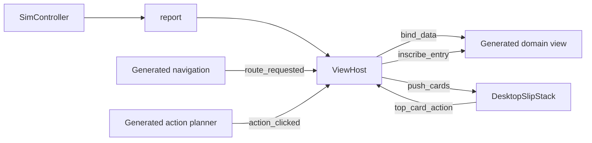

# Modular Filofax UI: How To

## Purpose

The Filofax UI is assembled from small presentation modules. Data and actions
flow through stable contracts instead of direct references between individual
views:



## Core contracts

### Generated views

Generated views under `generated/ui/` expose:

- `bind_data(data: Dictionary)` for current domain state.
- `inscribe_entry(entry: Dictionary)` for diary, ledger, or docket entries
  when the schema enables inscription.
- `action_clicked(action_code: String)` for action planner commands.

Do not edit generated files directly. Change the source JSON schema under
`data_modules/core/ui_schemas/` and run the UI compiler.

### `ViewHost`

`ViewHost` owns orchestration:

```gdscript
view_host.register_view("DIARY", diary_view)
view_host.switch_to_domain("DIARY")
view_host.attach_action_system(planner, inbox, composer_modal)
```

It calls `bind_data`, sends simulation results to the inbox, and files
feedback into the selected domain through `inscribe_entry_to_domain`.

### Inbox payload

Simulation feedback cards should use this shape:

```gdscript
{
	"stationery_profile": "STICKY_NOTE",
	"destination": "DIARY",
	"display_text": "Task settled.",
	"tick": 1,
	"week": 1,
	"success": true,
	"author": "Runner Dispatch"
}
```

`DesktopSlipStack` accepts this contract through `push_cards(cards: Array)`.
For compatibility with older callers it also accepts `text`, `slip_style`, and
`push_slips`.

The top-card interaction emits:

```gdscript
top_card_action(action_id: String, card_payload: Dictionary)
```

`action_id` is `FILE` or `DISCARD`. It also emits the legacy-friendly
`slip_filed`, `slip_discarded`, and `stack_count_changed` signals.

## Adding the desktop inbox

1. Instance `res://scenes/ui/shells/filofax/desktop_slip_stack.tscn`.
2. Pass the instance to `ViewHost.attach_action_system()` or
   `ViewHost.attach_planner_and_inbox()`.
3. Ensure the instance is reachable from the active `ViewHost`.
4. Push only normalized simulation cards:

```gdscript
var cards: Array = [{
	"stationery_profile": "STICKY_NOTE",
	"destination": "DIARY",
	"display_text": "The order completed.",
	"tick": 4,
	"author": "Runner Dispatch"
}]
inbox.push_cards(cards)
```

`ViewHost` receives `FILE` and writes the card into the destination view. A
discard action removes the card without inscription.

The normal city-view bootstrap already follows this path: it instantiates the
desktop inbox in `scenes/3d_scenes/city_view.gd` and passes it to
`ViewHost.attach_action_system()`.

## Styling and configuration

Stationery definitions and inbox rules are loaded by
`StationeryRegistry` from:

`res://data_modules/core/ui_schemas/stationary/manifests/filofax_1984_inbox.json`

Use the manifest's `stack_rules` for maximum visible cards, tilt, jitter, and
presentation order. Keep the widget independent of specific generated view
classes so it can be mounted in any shell.

## Testing checklist

- Instantiate the scene without errors.
- Call `push_cards()` with one success and one failure card.
- Confirm the unread count changes.
- Confirm `FILE` reaches `ViewHost._on_card_stack_triage`.
- Confirm `DISCARD` removes only the top card.
- Confirm generated views continue to receive `bind_data()` and
  `inscribe_entry()`.
